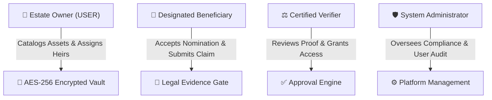
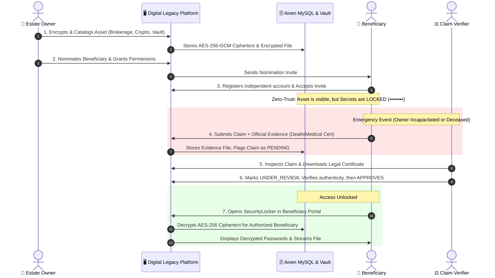
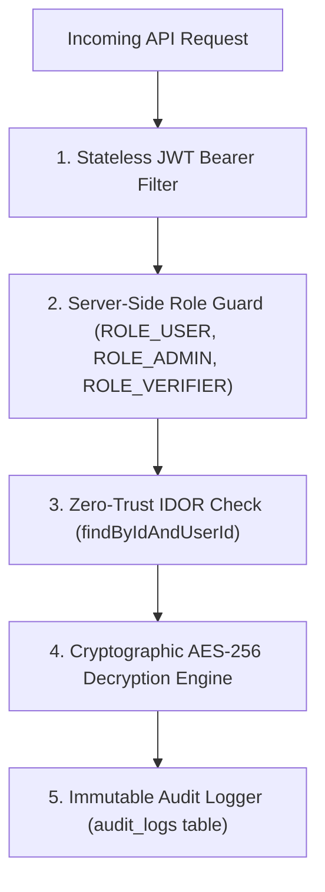

# 🏛️ Digital Legacy Manager: Client Presentation Master Guide

> **Confidential & Proprietary** | Comprehensive Pitch, Technical Architecture, Business Case & Demonstration Blueprint

---

## 📋 Executive Overview

**Digital Legacy Manager** is a secure, enterprise-grade, full-stack digital estate management and asset inheritance platform engineered with **Java 21**, **Spring Boot 3.3.5**, **React 18**, **Vite**, and **MySQL 8.0**.

It bridges the critical gap between lifetime digital ownership and posthumous asset recovery: allowing individuals to securely catalog digital assets, designate trusted beneficiaries, configure granular permissions, and execute **cryptographically locked, legally verified inheritance transfers** in critical emergencies.

---

## 🎯 1. The "Why": The Real-World Crisis & Market Problem

### The Problem in Numbers
* **$140+ Billion** in cryptocurrency, digital investments, and locked online assets are permanently lost every year due to deceased or incapacitated owners who never shared their private keys or credentials.
* **Over 90% of adults** have substantial digital footprints (brokerages, bank accounts, cloud vaults, intellectual property, crypto, domains, social accounts), but **fewer than 7%** have an estate plan that accounts for digital assets.
* **The Traditional Will Failure:** Traditional paper wills are slow (months of probate court), public, static, and cannot hold dynamic passwords or 2FA recovery codes without massive security risks.
* **Existing Tech Failures:** Big-tech tools (e.g., Google Inactive Account Manager, Apple Legacy Contact) are siloed within their own walled gardens, leaving financial portfolios, crypto keys, and cross-platform vaults inaccessible.

### The Zero-Trust Dilemma
* **Owners want privacy today:** No one wants to give their children, attorneys, or spouses their active passwords, crypto seed phrases, or private accounts while they are still healthy.
* **Beneficiaries need access tomorrow:** When an emergency (death, coma, incapacitation) occurs, heirs need immediate, legal, verified access without undergoing months of probate litigation.

---

## 💡 2. The "What": The Product Solution

Digital Legacy Manager solves this dilemma using an **Independent Multi-Party Zero-Trust Architecture**:

1. **Military-Grade Encryption at Rest:** All sensitive credentials, account numbers, and seed phrases are encrypted using **AES-256-GCM** authenticated encryption with unique initialization vectors (IVs).
2. **Password-Free Independent Beneficiary Model:** Beneficiaries register with their own independent credentials. They **never receive the owner's master password**.
3. **Cryptographic Zero-Trust Locking:** Even after being assigned an asset, beneficiaries see masked placeholders (`••••••••`) and cannot download or preview files under normal conditions.
4. **Legally Gated Verification Workflow:** Access is unlocked **only** after a formal claim is filed, verified evidence (e.g., Death Certificate, Medical Power of Attorney) is provided, and a licensed human Verifier approves the claim.
5. **SecurityLocker Stream Access:** Once approved, designated credentials dynamically decrypt in real time, and encrypted files stream securely to the beneficiary's browser without ever persisting unencrypted on the disk.

---

## 👥 3. The "Who": User Personas & Role-Based Control

The system implements four strictly isolated user roles:

| Persona | Primary Interface | Core Responsibilities |
|---|---|---|
| **Estate Owner** | **User Panel** (`/user/*`) | Catalogs digital assets across 11 categories, assigns beneficiaries with percentage allocations, defines access permissions, and monitors activity feeds. |
| **Beneficiary** | **Beneficiary Portal** (`/user/inherited-assets`) | Accepts/declines estate invitations, views assigned assets (in locked zero-trust state), files inheritance claims with legal proof, and accesses unlocked assets via **SecurityLocker**. |
| **Verifier** | **Verifier Review Center** (`/verifier/*`) | Dedicated neutral entity that reviews emergency claims, inspects uploaded legal certificates, marks claims under review, and approves/rejects asset unlocking. |
| **Administrator** | **Admin Panel** (`/admin/*`) | Strictly isolated administrative control, system-wide metrics, user deactivation/suspension, global audit log trails, and platform settings. |

---

## 🔄 4. The "How": End-to-End System Workflow

---

## 💻 5. "Why These Technologies Only?": Engineering Justifications

When clients ask **"Why did you choose this exact stack instead of alternatives?"**, use these battle-tested technical justifications:

### 1. Java 21 & Spring Boot 3.3.5 (Backend Layer)
* **Why not Node.js / Python?** 
  Financial and estate management systems require **strict static typing, rock-solid multithreading, and compile-time correctness**. Java 21 delivers Virtual Threads (Project Loom) for ultra-high concurrency and low memory footprint.
* **Why Spring Boot 3.3.5?** 
  Spring Security 6 provides the world's most rigorously audited role-based security framework. Spring Data JPA guarantees transaction atomicity (ACID compliance) so assets are never partially transferred.

### 2. React 18 & Vite 5 (Frontend Layer)
* **Why not Next.js / Angular?** 
  The platform is a secure Single Page Application (SPA) with complex state workflows (modals, encrypted password revealing, inline PDF/image streaming). Vite compiles via ES modules with sub-second Hot Module Replacement (HMR) and produces an optimized, zero-overhead client bundle.
* **Why React 18?** 
  Concurrent rendering and stateful hooks allow reactive UI updates (e.g. toggling masked credentials, dynamic file progress bars, responsive modal dialogs) with zero page flicker.

### 3. MySQL 8.0 & Flyway Migrations (Persistence Layer)
* **Why not MongoDB / NoSQL?** 
  Estate assets, permission relationships, emergency claims, and audit logs are **strictly relational**. A NoSQL database lacks native foreign-key constraints and ACID transaction guarantees. MySQL 8 delivers enterprise relational integrity with JSON column capabilities and UTF8MB4 international character encoding.
* **Why Flyway?** 
  Ensures zero-drift database migrations across local, testing, staging, and production environments with full version history (`V1__schema.sql`, `V2__seed.sql`, etc.).

### 4. AES-256-GCM Authenticated Encryption (Cryptography)
* **Why not AES-CBC or plain RSA?** 
  **AES-GCM (Galois/Counter Mode)** provides both **confidentiality and authenticity** (AEAD). It prevents bit-flipping attacks because any tampering with ciphertext or initialization vectors (IV) immediately causes a decryption authentication tag failure.
* **BCrypt with Cost Factor 12:** All user passwords are encrypted using BCrypt with 12 computational rounds, rendering rainbow table and GPU dictionary attacks mathematically infeasible.

---

## 🛡️ 6. Zero-Trust Security & Enterprise Defense Architecture

1. **Strict IDOR Mitigation (Insecure Direct Object Reference):** 
   Every query for assets or beneficiary files enforces ownership matching (`findByIdAndUserId`). Even if a user guesses another user's asset ID in an API call, the server returns an automatic `404/403`.
2. **Administrative Role Isolation:**
   Admin authentication (`/admin/login`) is strictly isolated from standard user authentication. Standard users attempting to access `/api/admin/*` endpoints receive instantaneous 403 Forbidden responses.
3. **Zero Knowledge in Storage:**
   All files stored in the file system vault (`uploads/documents/*.enc`) are encrypted binary blobs. Even if an attacker steals the storage drive, they cannot view a single document or read a single password without the server's private secret keys.
4. **Immutable Audit Trails:**
   Every login, password modification, asset creation, claim submission, verifier decision, and document download writes an unmodifiable record to `audit_logs` tracking user ID, action, target entity, client IP address, and UTC timestamp.

---

## 🎬 7. Live Demonstration Script for Clients

Follow this chronological walkthrough during a live demonstration:

### Scene 1: The Estate Owner Prepares Their Legacy
1. **Login:** Open [http://localhost:5173/login](http://localhost:5173/login) and log in with Demo Estate Owner: `user@digitallegacy.com` / `User@12345`.
2. **Dashboard:** Show the executive metrics: total assets, category distribution charts, recent activity feed.
3. **Digital Assets:** Navigate to **Digital Assets**. Show the catalog (Brokerage, Crypto Wallet, Swiss Bank Vault).
4. **AES-256 In Action:** Click the "Eye" icon to demonstrate on-the-fly revealing and masking of encrypted account identifiers.
5. **Beneficiary Assignment:** Go to **My Beneficiaries**. Show how beneficiaries are assigned specific assets with conditional rights (`VIEW`, `DOWNLOAD`, `EMERGENCY_ACCESS`).

### Scene 2: The Beneficiary's Zero-Trust Experience
1. **Open Incognito Window:** Navigate to [http://localhost:5173/login](http://localhost:5173/login) and log in with a beneficiary account.
2. **Assigned Assets:** Show that the beneficiary can see *what* they are designated to inherit, but **passwords and documents are locked** (`••••••••`). Explain to the client: *"This guarantees the owner's privacy while they are alive."*

### Scene 3: The Emergency & Claim Submission
1. **Submit Claim:** Under the Beneficiary Portal, click **"Submit Inheritance Claim"**.
2. **Select Reason:** Choose `DEATH_VERIFICATION` or `MEDICAL_EMERGENCY`.
3. **Upload Proof:** Upload a sample medical report / death certificate PDF.
4. **Track Status:** Show that the claim status is now **PENDING**.

### Scene 4: The Verifier Center
1. **Login as Verifier:** Log in at [http://localhost:5173/login](http://localhost:5173/login) using `verifier@digitallegacy.com` / `Verifier@12345`.
2. **Review:** Open the incoming claim. Download and inspect the uploaded evidence document.
3. **Approve:** Change status to `UNDER_REVIEW` and click **"Approve Claim"** with reviewer notes.

### Scene 5: The Post-Approval Unlock (SecurityLocker)
1. **Switch Back to Beneficiary Portal:** Refresh the page.
2. **Instant Decryption:** Show that the asset is now unlocked under **"Authorized Documents"**.
3. **SecurityLocker Viewer:** Open the **SecurityLocker** inline viewer to stream the decrypted legal document and reveal the previously masked credentials.

### Scene 6: The Admin Governance Overview
1. **Admin Portal:** Open [http://localhost:5173/admin/login](http://localhost:5173/admin/login) and log in with `admin@digitallegacy.com` / `Admin@123`.
2. **Compliance Trail:** Show the comprehensive user directory, platform-wide metrics, and the immutable **Audit Logs** proving that every step of the transfer was recorded with IP and timestamp.

---

## ❓ 8. Client Q&A Defense Cheat Sheet

Use these exact answers when clients raise tough questions:

| Question from Client | Winning Answer |
|---|---|
| *"Can platform employees or system administrators read my passwords or private keys?"* | **No.** Sensitive fields are encrypted using AES-256-GCM. In production, encryption keys are held in dedicated Hardware Security Modules (AWS KMS / Azure Key Vault / HashiCorp Vault), meaning no human database administrator or developer can view plaintext secrets. |
| *"What happens if a malicious beneficiary uploads a fake certificate to steal assets?"* | **The claim cannot self-execute.** An upload alone does not grant access. A certified human Verifier or estate attorney must independently inspect and validate the document against official state/hospital registries before any decryption trigger occurs. Additionally, the owner receives alerts to contest fraudulent claims. |
| *"What if the owner recovers from an emergency or medical coma?"* | **Full revocability.** Estate owners can revoke permissions, suspend beneficiary links, or reset vault assets at any time with a single click from their Estate Control Panel. |
| *"Is this compliant with digital estate laws?"* | **Yes.** The platform aligns with the **Revised Uniform Fiduciary Access to Digital Assets Act (RUFADAA)** and strict data privacy regulations (GDPR / HIPAA) by requiring explicit, granular owner authorization and immutable audit logs. |
| *"What if our organization wants to deploy this on private cloud or on-premise?"* | **Fully containerized.** The entire stack (MySQL 8, Spring Boot Backend, Vite/Nginx Frontend) is orchestrated via [docker-compose.yml](file:///C:/Project%20Codebegun/docker-compose.yml) and can be deployed onto private Kubernetes clusters, AWS, Azure, or on-premise private clouds in minutes. |
